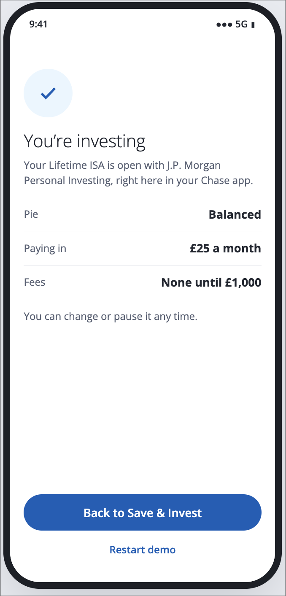

# Investing simulator: a Chase UK app concept

> **Concept prototype for the JPMorganChase Case Challenge. Not a real Chase or J.P. Morgan product.** Education, not financial advice.

**[Try it live →](https://j3kn3e.github.io/chase-investing-simulator-concept/)** · [Watch the demo](demo.mov)

## The problem

According to the FCA's Financial Lives 2024 survey, 61% of UK adults with £10,000+ in investible assets keep at least three-quarters of it in cash. Most 18–24s aren't there yet: their typical investible assets are £1,000–£2,000, and 44% have less than £1,000.

For a first-time investor, the first step isn't choosing a fund. It's having the confidence to start small.

## How it works

1. **Pick a ready-made pie**: cautious, balanced or adventurous.
2. **Replay a real year with pretend money**: the last 12 months, the tough year of 2022, or the last 5 years, using real daily market prices.
3. **Live through the dips**: when markets fall, the replay pauses, explains why in plain English, and asks *hold or sell?* Then it shows you what that choice would have meant.
4. **Start for real from £1**: round-ups or a monthly amount, into a Lifetime ISA or a Stocks & Shares ISA, with the risks spelled out first.

## Design choices

- **Jargon explained where it appears**: every term gets a one-line answer at the bottom of the screen that uses it.
- **Bad outcomes shown honestly**, including results after fees and a 5-year history, not just growth.
- **Accessible**: keyboard focus states, labelled charts and plain-English copy.

## About the data

The replay uses real daily closing prices (Oct 2021 – Oct 2026) for two index funds in £: Vanguard FTSE All-World (shares) and iShares Core Global Aggregate Bond, £-hedged (bonds), mixed to each pie's split. A real version would use J.P. Morgan's own portfolio prices. Past performance is not a reliable indicator of future results.

## Run it

It's a single HTML file with no build step: open `index.html` in a browser.
